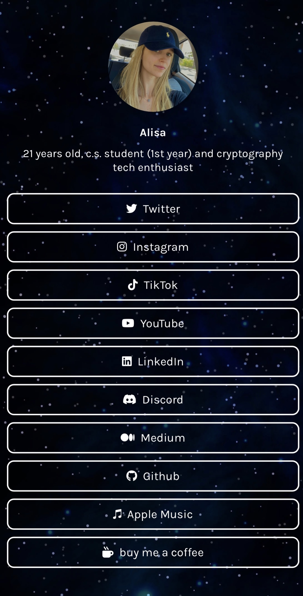

# Linktree ✨
Esta es una alternativa gratuita (y fácil de usar) a Linktree 

 

---
 
## Demo

<a href="https://demo.algofam.me" target="_blank">Mi página de Linktree</a>
   

## Ejemplo de <a href="https://github.com/ho0ber" target="_blank">@ho0ber</a>
https://links.sam.codes  
También creó <a href="https://github.com/ho0ber/lazylinks" target="_blank">Lazylinks</a>: un paquete simple de Python que facilita la escritura de contenido y la generación de HTML estático para desplegar, y puedes leer más al respecto en su <a href="https://blog.sam.codes/lazylinks-link-pages-for-lazy-people.html" target="_blank">blog</a>  

---

## Cómo personalizar la plantilla (qué líneas debes cambiar)

### Archivo index.html
1. línea 7 - título del sitio web  
2. línea 10 - imagen del ícono del sitio web  
3. línea 14 - imagen de perfil  
4. línea 16 - nombre de usuario  
5. línea 17 - descripción  
6. líneas 20-49 - tus enlaces de redes sociales  

### Archivo style.css
1. línea 4 - color del texto  
2. línea 5 - fuente
3. línea 16 - tu imagen/color de fondo

#### Si quieres cambiar los colores del nombre de usuario y la descripción:
Digamos que a 'red' para el ejemplo 
- nombre de usuario - agrega 'color: red;' después de la línea 40
- descripción - agrega 'color: red;' después de la línea 44
- ambos - cambia la línea 11 de 'color: var(--textColor);' a 'color: red;'

---

## ¿Dónde alojar tu sitio web (gratis)? 
 
Netlify (fácil de navegar): https://netlify.app  
GitHub Pages (mejor para principiantes): https://pages.github.com  
Vercel: https://vercel.com/  
Heroku: https://www.heroku.com  

---

## Analítica 
Personalmente recomiendo usar Google Tag Manager y conectarlo con Microsoft Clarity  

Google Tag Manager: https://tagmanager.google.com/  
Microsoft Clarity: https://clarity.microsoft.com/  
Netlify Analytics (9$ al mes): https://docs.netlify.com/monitor-sites/analytics/  
Google Analytics: https://analytics.google.com  

---

## Íconos de Redes Sociales
Aquí puedes elegir los íconos deseados para cada enlace:  
https://fontawesome.com/search?o=r&m=free  

### Antes de usar:
* Asegúrate de elegir solo desde la sección "free" (gratuita).  
* Copia el código para HTML/CSS.  

### Cómo usarlo (Ejemplo)
Digamos que quieres usar el ícono de libro en lugar del de Twitter  

La línea debajo de tu enlace deseado contiene esta línea: "fab fa-twitter"  

Luego, después de encontrar el ícono que deseas y su código, 
pega el código en el mismo lugar donde estaba el anterior  

El código final debería verse así: "fa-solid fa-book"  

---

## Imagen de fondo 
Puedes cambiar el fondo a un color en lugar de usar una imagen.  

### Color de Fondo
background-color: #7E65F5;  
Puedes encontrar el código de color deseado aquí: https://www.color-hex.com  

### Color de Fondo Degradado
background-image: linear-gradient (#E8E0FF, #7E65F5);  
Generador de degradados CSS: https://www.css-gradient.com/  

---

## Otros Recursos Gratuitos
Coolors (paletas de colores): https://coolors.co  
ColorsWall (paleta de colores): https://colorswall.com  
Selector de colores CSS desde fotos: https://imagecolorpicker.com/  
Palabras clave de color CSS: https://www.w3.org/wiki/CSS/Properties/color/keywords#Basic_Colors  
Google Fonts: https://fonts.google.com/  
Favicon (íconos): https://favicon.io/  
BGJar (fondos SVG gratuitos): https://bgjar.com  
Box Icons (íconos gratuitos): https://boxicons.com
